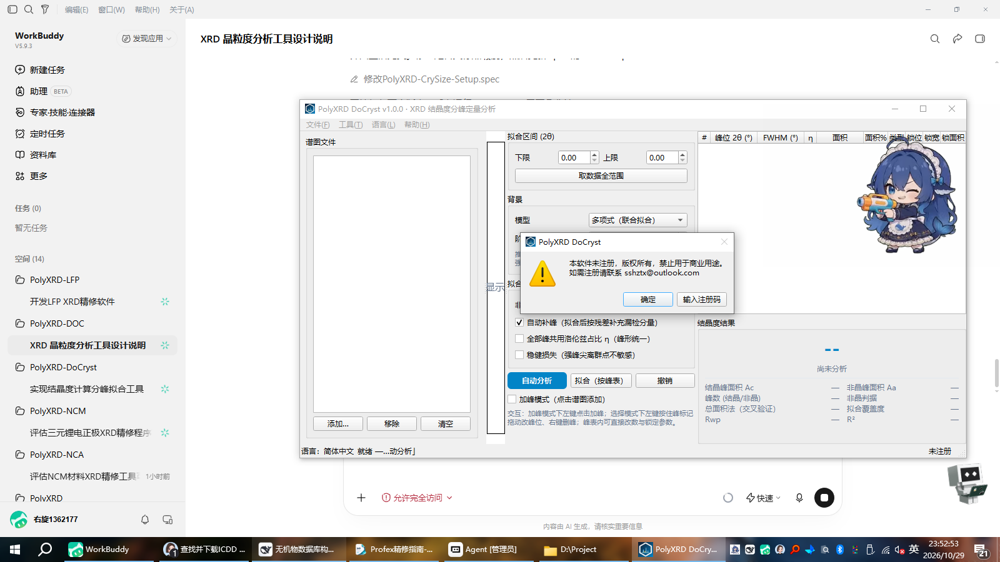

# PolyXRD DoCryst

**XRD 结晶度分峰定量分析工具**（PolyXRD 家族成员）

根据尖锐结晶峰的积分面积与非晶宽包的积分面积计算相对结晶度：

$$C = \dfrac{A_c}{A_c + A_a} \times 100\%$$

方法与思路参考 MDI Jade 6 的全谱分峰法（pseudo-Voigt 全谱拟合 + 直线背地 +
「FWHM > 3° 判为非晶峰」），并把其中最依赖手工经验的环节——**分峰与拟合**——
做成完全可控的交互操作：手动加峰、拖峰位、改参、锁参、手动改判结晶/非晶。

---

## 方法学

| 项目 | 本工具口径 | 说明 |
|---|---|---|
| 计算公式 | C = Ac/(Ac+Aa)×100% | Ac：全部结晶峰面积和；Aa：全部非晶宽包面积和 |
| 峰形 | 面积归一 pseudo-Voigt | **分量面积 = 解析恒等式**，不依赖数值积分截断（宽包尤其重要） |
| 非晶判据 | 拟合后 FWHM > 3.0°（0.5–15° 可调） | 与 Jade 系全谱拟合的通行口径一致；支持逐峰手动改判且改判后锁定 |
| 背景 | 多项式（默认，2–5 阶联合拟合）/ 端点直线（Jade 口径）/ 直线联合拟合 / 手动锚点 / SNIP（对照）/ 不扣 | 背景只扣缓变基底，**非晶包必须留在信号里参与拟合** |
| 拟合 | scipy TRF 带界最小二乘（背景 + 全部峰同时优化） | 支持 per-峰锁定 pos/FWHM/area；η 可统一共享 |
| 权重 | Poisson（σ=√y）或均匀 | Rwp/R²/拟合覆盖度随结果给出 |
| 不确定度 | σ(C) 由面积协方差**完整传播**（含峰间相关） | 锁定参数方差记 0 |
| 交叉验证 | 总面积法（窗口内梯形积分） | 与主口径的差值 = 非晶峰尾落在窗口外的比例 |

**重要口径说明**：主指标 C 用分量**解析面积**（窗口无关）；「总面积法」只用窗口内
积分。两者应接近；差值大说明非晶包没被窗口包全。

### 合成数据验证（节选，完整脚本见 tests/test_core.py）

| 场景 | 真值 C | 拟合 C | 偏差 |
|---|---|---|---|
| 无噪 / 无背景 | 45.455% | 45.45% | +0.00 pp |
| 含噪 σ=12 / 无背景 | 45.455% | 45.50% | +0.04 pp |
| 递减指数背景 + 多项式背景 | 45.455% | 45.61% | +0.15 pp |
| 递减指数背景 + 端点直线 | 45.455% | 53.44% | **+7.98 pp（口径偏差）** |

> 端点直线在"非晶包于区间端点仍有强度"时会系统性低估 Aa（C 偏高）——这是
> Jade 传统口径的固有属性，本工具内置检测（非晶包端点强度比 > 3% 即警示），
> 推荐改用多项式背景或缩窄拟合区间。SNIP 会把宽包当背景削掉，仅作对照。

## 功能

- **一键自动分析**：寻峰 → 全谱拟合 → 残差迭代补峰（解决宽非晶包被尖峰
  掩蔽漏检的问题）→ 按 FWHM 判据分类 → 结晶度 + σ + 质量诊断；
- **交互式分峰**（核心）：
  - 加峰模式：点击谱图任意位置加峰（局部峰高/半宽自动初值）；
  - 拖动峰标记改峰位（实时预览）；右键删峰；
  - 峰表直接编辑峰位 / FWHM / η / 面积，三个锁定列控制参与拟合的参数；
  - 手动改判结晶/非晶（锁定后自动判据不再覆盖）；
  - 撤销（30 步）；
- **非晶判据可调**（默认 3.0°），判据附近峰自动提示敏感风险；
- **质量诊断**：Rwp、R²、拟合覆盖度、非晶端点强度比、FWHM 触界、
  阈值邻近峰等 8 类警示；
- **多格式读谱**（复用 PolyXRD-Converter）：xy/txt/dat/csv/mdi/gsas/
  xrdml/brml/ras/chi/raw 等 20+ 格式；
- **批量计算**：按当前参数对文件列表逐谱自动分析，汇总 CSV；
- **导出**：自包含 HTML 报告（谱图 base64 内嵌 + 峰表 + 方法说明）、
  CSV（UTF-8 BOM）、PNG、工程存档 `.dcy.json`（保存/载入完整分析状态）；
- **三语界面**（简体中文 / English / 日本語，运行时热切换）；
- **双版次**：内部评估版（单文件 exe，免安装）/ 注册版（Setup 安装包，
  注册机制复用 PolyXRD-Reg）。

## 界面



## 使用

```bash
# 源码运行（D:/Project/XRD/python310 已预装依赖）
python -m docryst.gui

# 构建
build_exe.bat      # 内部评估版 -> dist/PolyXRD-DoCryst-vX.Y.Z.exe
build_setup.bat    # 注册版    -> dist/PolyXRD-DoCryst-vX.Y.Z-Setup.exe
```

推荐流程：导入谱图 → 设拟合区间（包全非晶包）→ **自动分析** → 检查残差与
判类，必要时手动加峰/拖峰/锁参后**拟合（按峰表）** → 确认覆盖度 ≥ 95%、
Rwp ≤ 10% → 导出报告。

## 双版次

| 版次 | 产物 | 注册机制 | 状态栏 |
|---|---|---|---|
| 内部评估版 | `PolyXRD-DoCryst-vX.Y.Z.exe`（onefile） | 无（spec excludes 注册模块） | 居中红色「内部评估版本」 |
| 注册版 | `PolyXRD-DoCryst-vX.Y.Z-Setup.exe`（Inno Setup） | 启动检查 + 帮助菜单输入注册码 | 右侧注册单位 |

注册状态存于 `%APPDATA%\PolyXRD\Registration\`，卸载重装不影响。注册码由
开发方按「单位部门名称」生成（家族统一 PXRD1 格式，与 RutAna 等互通）。

## 许可

双许可：学术许可（非商业学术研究与教学，免费）/ 商业许可（另行联系）。
详见 LICENSE 与 LICENSE-CN。

© 2026 PolyXRD Team · sshztx@outlook.com · https://github.com/PolyXRD
