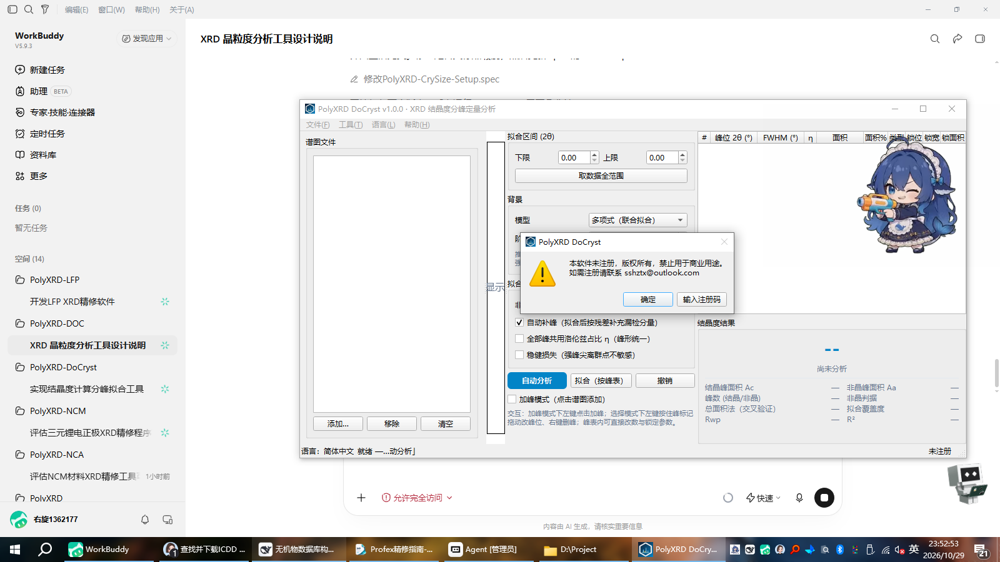

# PolyXRD DoCryst

**XRD crystallinity peak-decomposition quantitative analysis tool** (member of the PolyXRD family)

The relative degree of crystallinity is calculated from the integrated area of the sharp crystalline peaks and the integrated area of the amorphous broad halo:

$$C = \dfrac{A_c}{A_c + A_a} \times 100\%$$

The method and approach follow the full-pattern peak-decomposition method of MDI Jade 6 (pseudo-Voigt full-pattern fitting + straight-line background +
"FWHM > 3° classified as amorphous peak"), and the step that relies most on manual experience — **peak decomposition and fitting** —
is turned into a fully controllable interactive operation: manually add peaks, drag peak positions, change parameters, lock parameters, and manually override the crystalline/amorphous classification.

---

## Methodology

| Item | This tool's convention | Description |
|---|---|---|
| Calculation formula | C = Ac/(Ac+Aa)×100% | Ac: sum of all crystalline peak areas; Aa: sum of all amorphous broad-halo areas |
| Peak shape | Area-normalized pseudo-Voigt | **Component area = analytical identity**, does not depend on numerical integration truncation (especially important for broad halos) |
| Amorphous criterion | FWHM > 3.0° after fitting (adjustable 0.5–15°) | Consistent with the common convention of Jade-family full-pattern fitting; supports per-peak manual override, locked after override |
| Background | Polynomial (default, 2–5 order joint fit) / endpoint straight line (Jade convention) / straight-line joint fit / manual anchors / SNIP (for comparison) / none | The background subtracts only the slowly varying baseline; **the amorphous halo must remain in the signal and participate in the fit** |
| Fitting | scipy TRF bounded least squares (background + all peaks optimized simultaneously) | Supports per-peak locking of pos/FWHM/area; η can be shared globally |
| Weighting | Poisson (σ=√y) or uniform | Rwp/R²/fit coverage are reported with the results |
| Uncertainty | σ(C) is **fully propagated** from the area covariance (including inter-peak correlations) | Variance of locked parameters is taken as 0 |
| Cross-validation | Total-area method (trapezoidal integration within the window) | Difference from the main convention = fraction of the amorphous peak tail falling outside the window |

**Important convention note**: the main indicator C uses the component **analytical area** (window-independent); the "total-area method" uses only the integral within the
window. The two should be close; a large difference means the amorphous halo is not fully covered by the window.

### Synthetic-data validation (excerpt; see tests/test_core.py for the full script)

| Scenario | True C | Fitted C | Deviation |
|---|---|---|---|
| No noise / no background | 45.455% | 45.45% | +0.00 pp |
| With noise σ=12 / no background | 45.455% | 45.50% | +0.04 pp |
| Decreasing exponential background + polynomial background | 45.455% | 45.61% | +0.15 pp |
| Decreasing exponential background + endpoint straight line | 45.455% | 53.44% | **+7.98 pp (convention bias)** |

> When "the amorphous halo still has intensity at the interval endpoints", the endpoint straight line systematically underestimates Aa (C comes out too high) — this is
> an inherent property of the traditional Jade convention; this tool has a built-in check (a warning when the amorphous-halo endpoint intensity ratio > 3%),
> and recommends switching to a polynomial background or narrowing the fitting interval. SNIP treats the broad halo as background and removes it, so it is only used for comparison.

## Features

- **One-click automatic analysis**: peak finding → full-pattern fitting → iterative residual-based peak additions (solving the problem of the broad amorphous halo being
  masked by sharp peaks and missed) → classification by the FWHM criterion → degree of crystallinity + σ + quality diagnostics;
- **Interactive peak decomposition** (core):
  - Add-peak mode: click anywhere on the pattern to add a peak (local peak height / half-width used as automatic initial values);
  - Drag peak markers to change peak positions (live preview); right-click to delete a peak;
  - Edit peak position / FWHM / η / area directly in the peak table; three lock columns control which parameters participate in the fit;
  - Manually override the crystalline/amorphous classification (once locked, the automatic criterion no longer overrides it);
  - Undo (30 steps);
- **Adjustable amorphous criterion** (default 3.0°), with automatic sensitivity warnings for peaks near the threshold;
- **Quality diagnostics**: Rwp, R², fit coverage, amorphous endpoint intensity ratio, FWHM hitting bounds,
  peaks near the threshold, and 8 categories of warnings in total;
- **Multi-format pattern reading** (reusing PolyXRD-Converter): xy/txt/dat/csv/mdi/gsas/
  xrdml/brml/ras/chi/raw and 20+ other formats;
- **Batch calculation**: automatically analyse patterns one by one from a file list using the current parameters, summarized into a CSV;
- **Export**: self-contained HTML report (pattern embedded as base64 + peak table + method description),
  CSV (UTF-8 BOM), PNG, project archive `.dcy.json` (save/load the complete analysis state);
- **Trilingual UI** (Simplified Chinese / English / Japanese, runtime hot-switching);
- **Two editions**: internal evaluation build (single-file exe, no installation) / registered edition (Setup installer,
  registration mechanism reusing PolyXRD-Reg).

## UI



## Usage

```bash
# Run from source (dependencies are preinstalled in D:/Project/XRD/python310)
python -m docryst.gui

# Build
build_exe.bat      # Internal evaluation build -> dist/PolyXRD-DoCryst-vX.Y.Z.exe
build_setup.bat    # Registered edition    -> dist/PolyXRD-DoCryst-vX.Y.Z-Setup.exe
```

Recommended workflow: import a pattern → set the fitting interval (fully covering the amorphous halo) → **automatic analysis** → check the residuals and
classification, and if necessary manually add peaks / drag peaks / lock parameters then **fit (by peak table)** → confirm coverage ≥ 95%,
Rwp ≤ 10% → export the report.

## Two editions

| Edition | Artifact | Registration mechanism | Status bar |
|---|---|---|---|
| Internal evaluation build | `PolyXRD-DoCryst-vX.Y.Z.exe` (onefile) | None (spec excludes the registration module) | Centered red "Internal Evaluation Version" |
| Registered edition | `PolyXRD-DoCryst-vX.Y.Z-Setup.exe` (Inno Setup) | Startup check + enter registration code from the Help menu | Registered unit on the right |

Registration state is stored in `%APPDATA%\PolyXRD\Registration\`; uninstalling and reinstalling does not affect it. Registration codes are generated by the
developer from the "institution/department name" (family-wide unified PXRD1 format, interoperable with RutAna and others).

## License

Dual license: academic license (non-commercial academic research and teaching, free) / commercial license (contact separately).
See LICENSE and LICENSE-CN for details.

© 2026 PolyXRD Team · sshztx@outlook.com · https://github.com/PolyXRD
